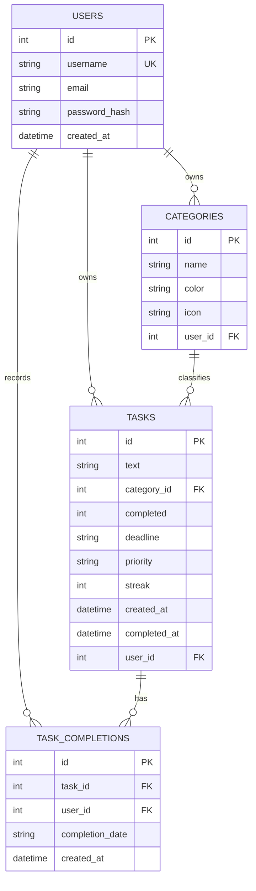

# Orbit • Habit & Task Mastery Web Application

<p align="center">
  
</p>

<p align="center">
  <strong>An ultra-modern, arcade-inspired Habit & Task Tracker web application built exclusively with HTML, CSS, JavaScript, and Python.</strong>
</p>

<p align="center">
  
  
  
  
</p>

---

## 📖 Table of Contents
1. [Project Overview](#-project-overview)
2. [Architecture & File Structure](#-architecture--file-structure)
3. [Technology Stack](#-technology-stack)
4. [Key Features & Mechanics](#-key-features--mechanics)
5. [Database Architecture & Schema](#-database-architecture--schema)
6. [API & Route Reference](#-api--route-reference)
7. [Security & Performance](#-security--performance)
8. [Getting Started & How to Run](#-getting-started--how-to-run)
9. [Test Credentials](#-test-credentials)

---

## 🌟 Project Overview

**Orbit** transforms daily task management and habit building into an engaging, gamified experience. Blending retro 8-bit arcade aesthetics with modern glassmorphism, Orbit delivers instantaneous visual and acoustic feedback, dynamic streak tracking, comprehensive monthly heatmaps, and multi-user isolation.

The project is structured cleanly into two dedicated directories:
- **`frontend/`**: Pure HTML5 templates, Vanilla CSS3 stylesheets, vanilla client-side JavaScript, vector SVG icons, and a PWA manifest.
- **`backend/`**: A lightweight, robust Python server utilizing Flask, SQLite3, and Werkzeug for session management, database migrations, habit completion calculations, and RESTful API endpoints.

---

## 📁 Architecture & File Structure

```text
Habit-Tracker-Webapp/
├── frontend/                     # All Client-Side Presentation & Assets
│   ├── index.html                # Main HUD Dashboard (Quests, Radar, Filters, Modals)
│   ├── auth.html                 # Pilot Login & Character Registration Gateway
│   ├── pack_calendar.html        # Monthly Habit Calendar & Heatmap Matrix
│   ├── manifest.json             # Progressive Web App (PWA) manifest configuration
│   ├── css/
│   │   └── style.css             # Comprehensive Arcade Pixel & Glassmorphism Design System
│   ├── js/
│   │   ├── app.js                # Core UI interactions, keyboard shortcuts & state sync
│   │   └── instant_actions.js    # Optimistic non-reload UI, 8-bit Web Audio synth & FX
│   └── icons/
│       └── icon.svg              # Scalable vector logo and favicon
│
├── backend/                      # All Server-Side Logic & Database Persistence
│   ├── app.py                    # Main Python Flask server, routes, and business logic
│   ├── requirements.txt          # Python dependencies (Flask, Werkzeug)
│   └── habits.db                 # SQLite relational database (Multi-user, tasks, logs)
│
├── .gitignore                    # Python, SQLite temporary files, and OS exclusions
├── HOW_TO_RUN.txt                # Plain text step-by-step setup and execution instructions
└── README.md                     # Comprehensive project documentation from start to end
```

---

## 💻 Technology Stack

| Layer | Technology | Details |
| :--- | :--- | :--- |
| **Frontend Markup** | **HTML5** | Semantic, accessible markup structured for Jinja2 template rendering |
| **Frontend Styling** | **Vanilla CSS3** | Custom design tokens, glassmorphism, retro pixel-art borders, dark/light themes |
| **Typography** | **Google Fonts** | *Plus Jakarta Sans*, *Inter*, *JetBrains Mono*, and *Silkscreen* |
| **Client Scripting** | **Vanilla JavaScript (ES6+)** | Web Audio API sound synthesis, optimistic UI sync, keyboard shortcuts |
| **Backend Framework** | **Python 3 & Flask** | Modular routing, request handling, session cookies, and REST APIs |
| **Database Engine** | **SQLite3** | Embedded relational database with foreign keys, constraints, and cascade deletion |
| **Security** | **Werkzeug Security** | Cryptographic password hashing (`scrypt`/`pbkdf2`) and HTTP-only session cookies |

---

## ✨ Key Features & Mechanics

### 1. 🛡️ Multi-User Pilot Authentication & Guest Demo
- User isolation: every task, habit group, and completion record belongs strictly to the authenticated `user_id`.
- **1-Click Demo Guest Mode**: Instant access with pre-seeded starter habits and tasks (`player1` / `orbit123`) for frictionless testing.
- Secure registration and login flows with password validation and encrypted hashes.

### 2. ⚡ Instant Non-Reload UI Sync & 8-Bit Web Audio Engine
- **Optimistic UI Updates**: Toggling or deleting a quest instantly updates the interface without any jarring browser reload.
- **Web Audio API Synthesizer**: Generates dynamic 8-bit sound effects (coin chimes, action blips, exp gains) purely in JavaScript without external MP3/WAV assets.
- **Floating EXP Particles**: Visual floating `+100 EXP!` animation upon completing habits.

### 3. 🎯 Habit Progress Radar & Momentum SVG Gauge
- **Live SVG Circular Meter**: Real-time calculated completion rate with smooth dash-offset transitions.
- **Horizontal Habit Trackers**: Category progress cards showing completion fractions (e.g., `3/4 CLEARED`), progress bars, and direct calendar links.

### 4. 📅 Monthly Calendar & Per-Quest Heatmap Matrix
- Full monthly calendar view displaying daily completion status:
  - 🟩 **Cleared**: All tasks completed for that day.
  - 🟨 **Partially Cleared**: At least one task finished.
  - 🟥 **Missed**: Past day with uncompleted tasks.
  - ⬜ **Future**: Upcoming calendar days.
- **Interactive Day Inspector**: Click any calendar day to inspect and retroactively toggle task completions for that specific date.
- **Horizontal Pixel Tracks**: Visual 30/31-day activity heat-strip for each quest accompanied by calculated consistency percentages.

### 5. ⏱️ Smart Deadline Presets & Task Priority
- Quick deadline chips: *Today Evening (6 PM)*, *Tonight (10 PM)*, *Tomorrow Morning (9 AM)*, *In 2 Days*, *Friday Evening*, or custom HTML5 date-time.
- Difficulty priorities: **Casual (Low)**, **Normal (Medium)**, and **Boss (Urgent)** with distinctive color badges.
- Automatic **[OVERDUE]** badge detection for active quests past their deadline.

### 6. 🎨 Pure CSS Modals & Theme Engine
- Clean modal creation for new habit categories using pure CSS `:target` triggers.
- Instant theme toggle between **Arcade Neon Dark** and **Famicom Light**, persisted across sessions via cookies.

---

## 🗄️ Database Architecture & Schema

The application uses an embedded **SQLite3** database (`backend/habits.db`) initialized automatically on startup:



### Table Definitions:
1. **`users`**: Stores player identities, unique usernames, optional email, and cryptographic password hashes.
2. **`categories`**: User-defined habit groups with custom neon colors and icons.
3. **`tasks`**: Individual quests containing difficulty priority, completion flag, streak count, deadline timestamp, and category references.
4. **`task_completions`**: Historical daily logs indexed by `(task_id, completion_date)` with a `UNIQUE` constraint, allowing accurate monthly calendar heatmaps and per-day analytics.

---

## 🔌 API & Route Reference

### HTML Template Routes (Views)
| Method | Route | Description |
| :--- | :--- | :--- |
| `GET` | `/` | Main HUD dashboard displaying active quests, habit radar, and filters |
| `GET` | `/login` | Pilot login screen (supports normal login and 1-Click Demo) |
| `POST` | `/login` | Processes authentication credentials or demo session creation |
| `GET` | `/register` | Player registration gateway |
| `POST` | `/register` | Validates registration, creates account, and auto-seeds starter habits |
| `GET` | `/logout` | Destroys active session and redirects to login |
| `GET` | `/set-theme/<theme>` | Switches cookie between `dark` and `light` and redirects back |
| `GET` | `/habits/<id>` | Opens habit calendar and monthly completion matrix for a category |

### Task & Habit Actions
| Method | Route | Description |
| :--- | :--- | :--- |
| `POST` | `/tasks/add` | Creates a new quest with category, priority, and deadline |
| `POST` | `/tasks/<id>/toggle` | Toggles completion, updates streak, logs completion date (supports AJAX) |
| `POST` | `/tasks/<id>/edit` | Updates quest text, priority, category, or deadline |
| `POST` | `/tasks/<id>/delete` | Deletes a task from database (supports AJAX) |
| `POST` | `/categories/add` | Creates a new habit category with custom color |
| `POST` | `/categories/<id>/delete` | Unlinks tasks and deletes habit category |
| `POST` | `/habits/<cat_id>/tasks/<task_id>/toggle-date` | Toggles task completion on a specific calendar date |

### REST API Endpoints (JSON)
| Method | Endpoint | Description |
| :--- | :--- | :--- |
| `GET` | `/api/tasks` | Returns JSON array of all tasks for the authenticated user |
| `POST` | `/api/tasks` | Creates a task via JSON payload |
| `PUT` | `/api/tasks/<id>` | Updates task attributes via JSON |
| `DELETE` | `/api/tasks/<id>` | Deletes task via JSON |
| `POST` | `/api/tasks/<id>/toggle` | Toggles task and returns updated stats & categories JSON |
| `GET` | `/api/categories` | Returns JSON array of categories with completion statistics |
| `POST` | `/api/categories` | Creates a category via JSON payload |
| `DELETE` | `/api/categories/<id>` | Deletes a category via JSON |
| `GET` | `/api/stats` | Returns real-time user statistics (cleared, active, completion rate, streaks) |

---

## 🔒 Security & Performance

- **Password Hashing**: Passwords are never stored in plaintext. Passwords are securely hashed using Werkzeug's cryptographic `scrypt` / `pbkdf2:sha256` key derivation functions.
- **Session Protection**: Flask session cookies are flagged with `HttpOnly` and `SameSite='Lax'` to prevent cross-site scripting (XSS) session theft.
- **SQL Injection Prevention**: All SQL queries utilize parameterized statements (`?` placeholders) with SQLite3 bindings.
- **Zero Heavy Frontend Dependencies**: No bloated JavaScript frameworks or external NPM packages. The client runs on lightweight native browser APIs (DOM, Web Audio, Fetch).

---

## 🚀 Getting Started & How to Run

> For detailed plain-text instructions, refer to [HOW_TO_RUN.txt](HOW_TO_RUN.txt).

### 1. Install Dependencies
```bash
pip install -r backend/requirements.txt
```

### 2. Run the Application Server
```bash
python backend/app.py
```

### 3. Access in Browser
Open your web browser and navigate to:
```
http://127.0.0.1:5000
```

---

## 🎮 Test Credentials

- **1-Click Demo**: Click the **★ 1-CLICK DEMO GUEST** button on the login screen.
- **Manual Demo Login**:
  - **Username**: `player1`
  - **Password**: `orbit123`
- **Custom Account**: Click **★ NEW PLAYER** to create your own character with auto-seeded starter habits.
